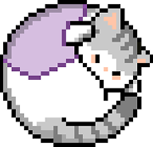

<div align="center">
  

  # 🐾 Pawse — Official Website
  **The Coziest Way to Get Things Done**

  *A desktop productivity app combining a focus timer with a virtual companion. Built for students, professionals, and cat lovers.*

  <p align="center">
    
    <!-- 🔗 REPLACE "YOUR_FIGMA_LINK_HERE" BELOW WITH YOUR FIGMA SHARE URL -->
    <a href="YOUR_FIGMA_LINK_HERE" target="_blank">
      
    </a>
  </p>

  <p align="center">
    
    
    
    
  </p>
</div>

---

## ✨ Overview

**Pawse** is a cozy desktop productivity application that pairs a Pomodoro focus timer with interactive virtual cat companions. While you focus on your tasks, your companion keeps you company on your desktop—making study and work sessions feel calmer, more rewarding, and less isolating.

This repository houses the **official web platform for Pawse**, designed to introduce the app's experience, showcase its pixel-art companions, highlight productivity analytics, and serve as the central hub for downloads and updates.

### 🌟 Key Website Highlights
- **Interactive Hero Experience:** Introduces Pawse's cozy aesthetic and core value proposition.
- **How It Works:** A step-by-step visual walkthrough of the focus timer and companion mechanics.
- **Meet Your Companions:** Showcases the distinct personalities and themes of **Tux**, **Ginger**, and **Void**.
- **Pomodoro Analytics:** Previews how users track their focus streaks and productivity habits.

---

## 🎨 UI/UX Design & Prototyping

This website was designed with a **design-first workflow** in **Figma** prior to frontend implementation, focusing on warm, approachable visuals that blend retro pixel charm with clean, modern web usability.

> 🔗 **Figma Design & Prototype:** [View the Interactive Design in Figma](YOUR_FIGMA_LINK_HERE)  
> *(Replace `YOUR_FIGMA_LINK_HERE` with your Figma file or prototype link)*

### 🖼️ UI Mockup Preview
<!-- 📸 TO ADD YOUR MOCKUP: Export your Figma frame as "figma-mockup.png", place it in the /public folder, and update the src below if needed -->
<div align="center">
  
  <p><em>High-fidelity landing page design created in Figma</em></p>
</div>

---

### 🖌️ Design System

The Figma design tokens are translated directly into CSS custom properties and Tailwind CSS v4 `@theme` tokens in [`app/globals.css`](./app/globals.css) to ensure pixel-accurate consistency between prototype and code.

#### 🔤 Typography
| Role | Font Family | Usage |
| :--- | :--- | :--- |
| **Display / Headings** | `Pixelify Sans` | Playful pixel-styled titles and hero headings that reflect the virtual pet aesthetic |
| **Body & UI Controls** | `Inter` | Clean, high-legibility sans-serif for body copy, navigation, and long-form reading |

#### 🎨 Color Palette
| Token | Hex | Swatch | Role |
| :--- | :--- | :---: | :--- |
| `--color-accent` | `#35A6F1` |  | Primary brand accent & interactive highlights |
| `--color-accent-highlight` | `#A8DCFF` |  | Soft secondary accent & hover states |
| `--color-companion-tux` | `#ECFEA9` |  | Companion theme color — **Tux** |
| `--color-companion-ginger` | `#FEE1A9` |  | Companion theme color — **Ginger** |
| `--color-companion-void` | `#E0A9FE` |  | Companion theme color — **Void** |
| `--color-stroke` | `#E4E4E7` |  | Subtle borders, dividers, and card outlines |

---

## 🛠️ Tech Stack

- **Framework:** [Next.js](https://nextjs.org/) (App Router)
- **Library:** [React 19](https://react.dev/)
- **Language:** [TypeScript](https://www.typescriptlang.org/)
- **Styling:** [Tailwind CSS v4](https://tailwindcss.com/)
- **Design & Prototyping:** [Figma](https://www.figma.com/)

---

## 🚀 Getting Started Locally

1. **Clone the repository:**
   ```bash
   git clone https://github.com/jjobligado/pawse-website.git
   cd pawse-website
   ```

2. **Install dependencies:**
   ```bash
   npm install
   ```

3. **Run the development server:**
   ```bash
   npm run dev
   ```

4. **Open in your browser:**  
   Visit [http://localhost:3000](http://localhost:3000) to view the application.
